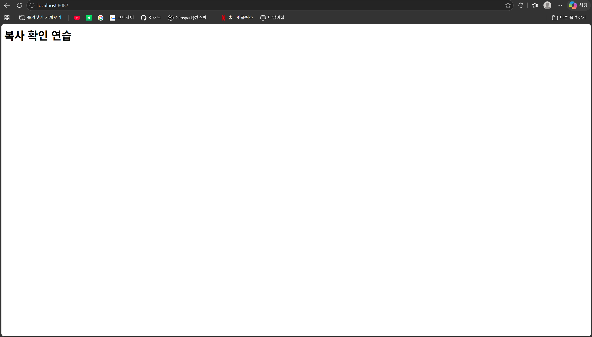
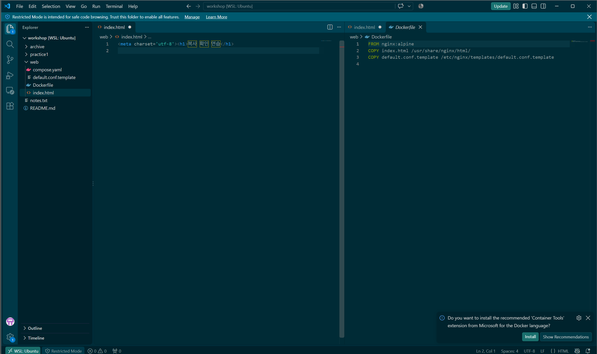
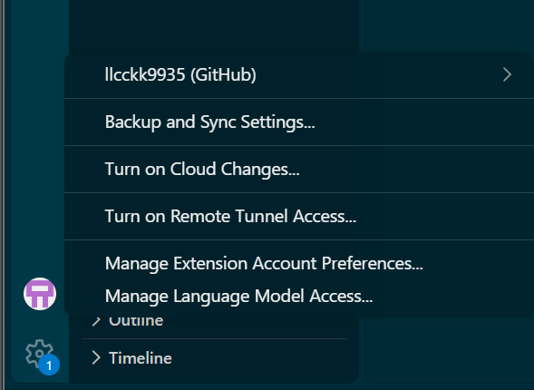

# 내 컴퓨터에 개발자용 작업실 꾸미기

Windows 노트북에 WSL 2 Ubuntu와 Docker Desktop을 연결하고, 직접 작성한 Dockerfile로 웹 서버를 만들었다. CLI·권한·컨테이너 운영·스토리지·Git/GitHub를 실습하고 Compose, 컨테이너 간 통신, 환경 변수, SSH 인증까지 확장했다.

제출 저장소: [llcckk9935/E1-1](https://github.com/llcckk9935/E1-1)

아래 실제 검증과 학습자 보고를 구분한다. 명령 예시를 실제 성공 출력으로 취급하지 않는다. 모든 검증 증거는 이 문서의 상대 링크로 연결한다.

## 1. 실행 환경

| 항목 | 확인한 환경 |
|---|---|
| 호스트 OS | Windows 11 Home, 빌드 26200 |
| Linux | WSL 2의 Ubuntu 26.04.1 LTS |
| WSL 프로그램 | 3.0.3.0 — 배포판의 WSL 세대 2와 별개 |
| 셸 | Ubuntu Bash, Windows PowerShell 5.1.26100.9711 |
| 터미널 | Windows의 PowerShell 실행 창 및 Ubuntu 셸 사용. 터미널 앱 이름 별도 미확인 |
| 에디터 | VS Code 1.144.1, WSL Ubuntu 작업 폴더 연결 |
| Docker CLI / Server | 29.9.2 / 29.9.2, Docker Desktop Linux 엔진 |
| Docker Compose | v5.6.1 |
| Git | Ubuntu 2.53.0 / Windows 2.55.0.windows.5 |

설치·확인 과정: [환경 기록](evidence/ch01/environment.md), [Docker 점검](evidence/ch01/docker-info.md), [Ubuntu 연결 복구](evidence/ch01/docker-group-session.md).

## 2. 제출 항목과 검증 위치

- [x] 기본 CLI와 파일 시스템
- [x] 파일·디렉토리 권한 변경 실험
- [x] Docker 설치·운영·hello-world·Ubuntu·attach/exec 관찰
- [x] 직접 작성한 Dockerfile·커스텀 이미지·웹 서버
- [x] 포트 접속 화면·바인드 마운트 전후 응답·볼륨 삭제 전후 비교
- [x] Git 설정·GitHub SSH 업로드·VS Code 연결 증거
- [x] 실제 트러블슈팅 2건 이상
- [x] 선택 5종: 단일 Compose·다중 컨테이너 통신·Compose 운영·환경 변수·SSH

체크는 수행 확인을 뜻하며, 원문이 없는 실행 보고는 증거 열에 표시한다. 필수·선택 분류는 [과제 원본](과제_원본.md)을 따른다. 선택 5개도 모두 수행 대상으로 삼았다.

| 구분 | 항목 | 상태·검증 증거 |
|---|---|---|
| 필수 | CLI 파일·폴더 조작 및 경로 | [초기 학습·경로](evidence/ch02/cli.md), [실제 출력 보완 검증](evidence/ch02/cli-review.md) |
| 필수 | 파일·디렉토리 권한 변경 | [전후 권한·Permission denied·복구·640 적용](evidence/ch03/permissions.md) |
| 필수 | Docker 설치·데몬 점검 | [버전·엔진 응답](evidence/ch01/docker-info.md) |
| 필수 | hello-world·Ubuntu 내부 명령 | [실제 출력](evidence/ch05/docker.md) |
| 필수 | 이미지·컨테이너 운영 | [pull/images/ps/logs/stats/stop 대응표](evidence/ch05/operations.md) |
| 필수 | attach·exec와 종료·유지 | [비교 관찰](evidence/ch05/lifecycle.md) |
| 필수 | 커스텀 이미지 빌드·실행 | [첫 빌드](evidence/ch06/build-run.md), [HTML 변경 후 재빌드](evidence/ch06/copy-rebuild.md) |
| 필수 | 포트 매핑·접속 | [8082 주소창과 응답 화면](evidence/ch07/ports.md) |
| 필수 | 바인드 마운트 변경 반영 | [초기 관찰](evidence/ch07/bind-mount.md), [호스트 파일 변경 전후 실제 HTTP 응답](evidence/ch07/bind-response.md) |
| 필수 | 볼륨 데이터 영속성 | [컨테이너 삭제 전후 동일 메모 출력](evidence/ch07/volume.md) |
| 필수 | Git 설정·GitHub·VS Code | [사용자·브랜치 설정·커밋](evidence/ch04/git.md), [SSH push·연동 화면](evidence/ch04/github.md) |
| 필수 | 실제 문제 해결 2건 이상 | [설치·엔진·권한 문제 해결 기록](docs/troubleshooting.md) |
| 선택 1 | 단일 서비스 Compose | [up·접속·ps 출력](evidence/ch08/compose.md) |
| 선택 2 | 두 서비스·내부 통신 | [helper → web의 HTTP 응답](evidence/ch08/compose.md) |
| 선택 3 | Compose 운영 | [up/down/ps/logs 및 삭제 후 빈 목록](evidence/ch08/compose.md) |
| 선택 4 | 환경 변수 | [NGINX_PORT=8080 → listen 8080 → HTTP 응답](evidence/ch08/environment.md) |
| 선택 5 | SSH 인증·업로드 | [공개키 등록 보고·인증 성공·push 출력](evidence/ch04/github.md) |

## 3. 구성 파일

```text
web/
  Dockerfile                 # 기본 NGINX 이미지에 내 파일 추가
  index.html                 # 웹 페이지 내용
  default.conf.template      # 환경 변수로 포트를 채우는 설정 양식
  compose.yaml               # web과 helper 실행 설정
docs/                        # 설명·보안·트러블슈팅
evidence/                    # 명령·실제 출력·화면 증거
```

각 파일: [Dockerfile](web/Dockerfile), [HTML](web/index.html), [NGINX 설정 양식](web/default.conf.template), [Compose](web/compose.yaml).

베이스는 `nginx:alpine`이다. 웹 서버가 포함된 기존 이미지를 활용하고, `COPY`로 내 HTML과 포트 설정 양식을 추가했다. 직접 추가한 두 파일의 목적은 화면 내용 지정과 실행 시 서버 포트 변경이다. helper는 이미지 안에 추가한 파일이 아니라 Compose로 함께 실행하는 별도 Alpine 컨테이너다.

## 4. 웹 서버 재현 절차

다음은 평가자용 실행 절차이며 새로운 실행 결과를 만들어 적은 로그가 아니다. 실제 수행 결과는 위 증거 링크를 참고한다. Docker Desktop Linux 엔진과 Ubuntu WSL 연결이 준비된 환경에서 실행한다. 8082 포트가 다른 프로그램에 사용 중이면 Compose의 포트 매핑 왼쪽 숫자와 브라우저 주소를 함께 바꾼다.

```bash
git clone https://github.com/llcckk9935/E1-1.git
cd E1-1/web
docker build -t workshop-web:2.0 .
docker compose up -d
docker compose ps
```

Compose는 로컬의 `workshop-web:2.0` 이미지를 사용하므로 빌드를 먼저 해야 한다. 브라우저에서 `http://localhost:8082`에 접속하면 “복사 확인 연습” 제목이 표시된다. `8082:8080`은 호스트 8082를 컨테이너 내부 8080에 연결한다.



내부 통신과 서버 설정 확인:

```bash
docker compose exec helper wget -qO- http://web:8080
docker compose exec web cat /etc/nginx/conf.d/default.conf
docker compose logs --tail 10 web
```

helper는 웹 서버가 아닌 통신 확인용 컨테이너이며 `sleep 3600`으로 1시간 동안 유지된다. 시간이 지나 정지했다면 `docker compose up -d helper`로 다시 시작한 뒤 요청한다. 같은 Compose 네트워크에서 `web`은 서비스 이름으로 상대를 찾는 주소이며 내부 통신에는 호스트 포트 8082를 쓰지 않는다.

정리:

```bash
docker compose down
docker compose ps
```

down은 이 프로젝트의 서비스 컨테이너와 기본 네트워크를 제거한다. 소스와 설정 파일은 남는다. 별도의 docker run으로 실행한 과거 실습 컨테이너까지 모두 정리하지는 않는다.

## 5. 변경 반영과 데이터 보존

### COPY 방식

HTML 저장만 했을 때는 기존 제목이 유지됐고, 아래 순서 후 새 제목을 확인했다. [실제 비교와 커밋](evidence/ch06/copy-rebuild.md).

```bash
docker build -t workshop-web:2.0 .
docker compose up -d web
```

COPY는 빌드 시 복사다. 원본 저장만으로 이미지나 기존 컨테이너가 자동 갱신되지 않는다.

### 바인드 마운트

WSL의 실제 web 폴더를 컨테이너의 HTML 폴더에 연결했다. 호스트 HTML을 수정한 뒤 재빌드 없이 8081 화면이 바뀌었고, COPY만 사용한 8080 화면은 유지됐다. [실행 명령·전후 관찰](evidence/ch07/bind-mount.md). 후속 검증에서는 호스트에 bind-check.txt를 작성해 같은 URL을 curl로 요청했다. 재빌드·재시작 없이 “마운트 변경 전”에서 “마운트 변경 후”로 응답이 바뀐 [실제 출력](evidence/ch07/bind-response.md)을 확보했다.

기록의 `/home/llcckk/workshop/web`은 학습자 경로다. 다른 컴퓨터에서는 자신의 실제 폴더 경로로 바꿔야 한다. 현재 제출 Compose는 바인드 마운트를 사용하지 않으며 최종 화면의 제목으로 연결 방식을 판단하지 않는다.

### Docker 볼륨

`workshop-data`를 `/data`에 연결해 메모를 저장했다. 재검증에서 `volume-test2` 삭제 후 새 `volume-test3`에 같은 볼륨을 연결해 동일한 메모를 읽었다. [명령과 삭제 전후 실제 출력](evidence/ch07/volume.md).

```text
컨테이너를 삭제해도 이 메모는 남는다.
```

컨테이너 삭제와 볼륨 삭제는 별개다. 다른 빈 볼륨을 연결하면 이전 볼륨의 메모가 나타나지 않는다.

## 6. 환경 변수 적용

템플릿의 `listen ${NGINX_PORT};`와 Compose의 `NGINX_PORT: "8080"`을 연결했다. 시작 시 생성된 실제 설정의 `listen 8080;`과 helper의 `http://web:8080` 응답을 확인했다. [빌드·설정·동작 증거](evidence/ch08/environment.md).

환경 변수는 프로그램이 읽어 사용해야 동작에 반영된다. 이 실습은 NGINX 공식 이미지의 템플릿 처리 기능을 이용한다. 다른 내부 포트로 바꾸려면 변수 값과 매핑 오른쪽 숫자, 내부 통신 요청 포트를 함께 맞춘다.

## 7. Git·GitHub·VS Code

Git은 로컬 변경 이력을 관리하고, GitHub는 그 이력을 원격으로 보관·공유한다. GitHub 초기 README 커밋을 보존해 로컬 이력과 합친 뒤 SSH 인증으로 push했다. `practice1/`은 제출 커밋에서 제외했다.

초기 업로드는 `git push -u origin main`, 이후 제목 변경은 `git push`를 사용했다. 이후 status에서 `Your branch is up to date with 'origin/main'.`을 확인했다. [전체 명령·출력](evidence/ch04/github.md), [제목 변경 커밋 bd7e9e1](evidence/ch06/copy-rebuild.md).





WSL 작업 폴더와 GitHub 계정을 각각 확인한 화면이다. 캡처의 Restricted Mode나 미저장 탭 표시를 전체 설정 완료 또는 모든 파일 저장 완료 증거로 확대하지 않는다. 파일 변경은 실제 diff·커밋으로 따로 검증했다.

## 8. 실제 트러블슈팅과 보안

| 문제 | 확인·해결 요약 | 결과 |
|---|---|---|
| WSL 설치 후 가상화 관련 안내 | 재시작 여부 확인 후 Windows 다시 시작 | WSL 2 관련 오류 안내 소멸, 후속 Ubuntu 실행·WSL 2 등록 확인 |
| docker 명령 미인식 | 설치 경로 점검·공식 설치 후 새 셸에서 재확인 | docker --version 출력 확보 |
| Docker 엔진 연결 실패 | Docker Desktop 시작 후 docker info 재확인 | Server 정상 정보 확보 |
| Ubuntu 소켓 권한 거부 | 소켓 권한·현재 그룹·등록 그룹 비교 후 셸 재진입 | Ubuntu에서 엔진 정상 응답 확보 |

각 건의 문제 → 가설 → 확인 → 해결·재검증은 [트러블슈팅 문서](docs/troubleshooting.md)를 참고한다. 미확정 한글 입력 표시 문제는 해결 건수에 넣지 않는다. HTTPS 비밀번호 인증 실패와 SSH 전환은 [GitHub 기록](evidence/ch04/github.md)에, 컨테이너 이름 중복과 start를 이용한 재진입은 [볼륨 기록](evidence/ch07/volume.md)에 별도로 남겼다.

비밀번호·토큰·개인키·인증 코드는 기록하지 않는다. SSH 공개키만 GitHub에 등록하며 개인키는 컴퓨터에 보관한다. 공개된 비밀값이 있다면 단순 마스킹에 그치지 않고 폐기·재발급과 가능한 범위의 이력 정리가 필요하다. [보안 학습·기록 검토](docs/security.md).

## 9. 학습 문서와 남은 보완

- [명령어 길잡이](명령어_길잡이.md): 뜻·줄임말·사용 예시·주의점
- [목표 6개의 설명 기록](docs/explanations.md): 학습자의 답변과 보충 설명
- [40시간 학습계획](학습계획.md): 필수·선택과 챕터별 통과 조건
- [제출 관리](제출관리.md): 완료 확인과 보완 항목
- [제출 파일 점검](docs/submission-check.md): 링크·민감정보·전송 범위 점검

기본 CLI·볼륨·바인드 마운트는 후속 재검증의 실제 출력으로 보완했다. 증거 문서의 “아직 미확인” 같은 문구는 해당 학습 시점의 상태이며 이후 후속 검증과 함께 읽는다. 기록의 시간 순서를 보존하고 과거의 미수집 출력을 새로 만들지 않았다. 과제 목표의 자기 설명은 [별도 학습 기록](docs/explanations.md)에서 계속 점검한다.
