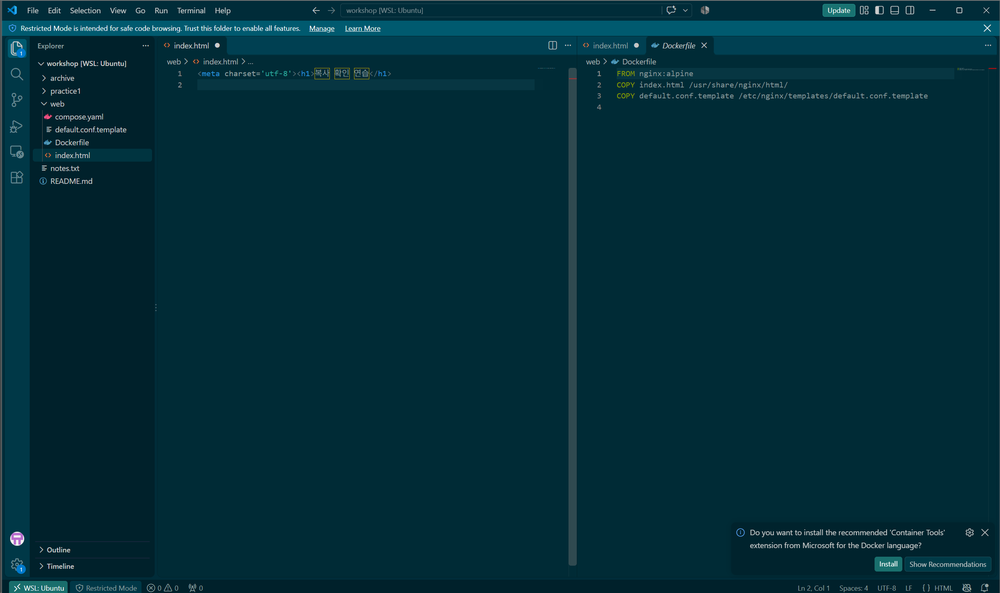
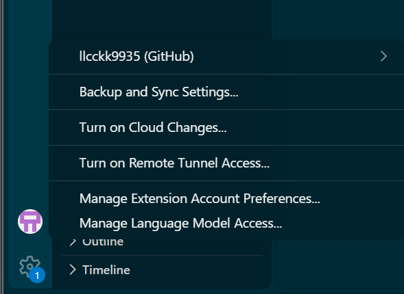

# GitHub 원격 연결·기존 이력 통합

출처: 학습자가 Ubuntu의 `~/workshop`에서 실행하고 대화로 제공한 출력이다. 업로드 성공은 아직 확인되지 않았다.

## 웹 파일 커밋

`git add web/` 후 `git status`에서 다음 4개만 스테이징된 실제 출력을 받았다. practice1/은 미추적 상태로 남았다.

- web/Dockerfile
- web/compose.yaml
- web/default.conf.template
- web/index.html

명령:

```bash
git commit -m "Docker 웹 서버와 Compose 실습 추가"
```

실제 출력:

```text
[main 80cb430] Docker 웹 서버와 Compose 실습 추가
 4 files changed, 19 insertions(+)
 create mode 100644 web/Dockerfile
 create mode 100644 web/compose.yaml
 create mode 100644 web/default.conf.template
 create mode 100644 web/index.html
```

## 원격 등록·가져오기

최초 `git remote -v`는 출력이 없었다. 다음 명령으로 등록하도록 안내했고 수행 보고를 받았다.

```bash
git remote add origin https://github.com/llcckk9935/E1-1.git
git remote -v
```

후속 조회 실제 출력:

```text
origin  https://github.com/llcckk9935/E1-1.git (fetch)
origin  https://github.com/llcckk9935/E1-1.git (push)
```

`git fetch origin`의 실제 출력:

```text
remote: Enumerating objects: 3, done.
remote: Counting objects: 100% (3/3), done.
remote: Compressing objects: 100% (2/2), done.
remote: Total 3 (delta 0), reused 0 (delta 0), pack-reused 0 (from 0)
Unpacking objects: 100% (3/3), 916 bytes | 305.00 KiB/s, done.
From https://github.com/llcckk9935/E1-1
 * [new branch]      main       -> origin/main
```

`git log origin/main --oneline`의 실제 출력:

```text
c3bf2d2 (origin/main, origin/HEAD) Initial commit
```

`git ls-tree --name-only origin/main`은 README.md를 표시했다. `git show origin/main:README.md`의 실제 출력:

```markdown
# E1-1
내 컴퓨터에 개발자용 '작업실' 꾸미기
```

## 기존 원격 커밋을 보존하며 병합

로컬과 원격에서 별도로 시작한 이력을 연결하도록 안내했다.

```bash
git merge origin/main --allow-unrelated-histories -m "GitHub 초기 README와 로컬 실습 이력 통합"
```

실제 출력:

```text
Merge made by the 'ort' strategy.
 README.md | 2 ++
 1 file changed, 2 insertions(+)
 create mode 100644 README.md
```

후속 `git status` 실제 출력:

```text
On branch main
Untracked files:
  (use "git add <file>..." to include in what will be committed)
        practice1/

nothing added to commit but untracked files present (use "git add" to track)
```

## HTTPS 인증 실패 후 SSH로 전환

첫 push는 인증에 실패했다. 다음은 제공받은 오류 원문이다.

```text
remote: Invalid username or token. Password authentication is not supported for Git operations.
fatal: Authentication failed for 'https://github.com/llcckk9935/E1-1.git/'
```

Ubuntu의 `ls -la ~/.ssh` 결과는 기본 폴더 없음이었다. `ssh-keygen -t ed25519 -C "E1-1 WSL"`로 키 생성하도록 안내했고 완료 보고를 받았다. 개인키 보호 암호·개인키 내용은 수집하지 않았다. 공개키 조회 및 GitHub Authentication Key 등록은 학습자가 완료 보고했다.

`ssh -T git@github.com`에서 제공된 서버 ED25519 지문은 `SHA256:+DiY3wvvV6TuJJhbpZisF/zLDA0zPMSvHdkr4UvCOqU`였으며 GitHub 공식 안내와 일치했다. 사용자가 yes로 known_hosts에 등록했다. 이후 실제 인증 출력:

```text
Hi llcckk9935! You've successfully authenticated, but GitHub does not provide shell access.
```

SSH 주소 전환 명령을 안내했고 실행 완료 보고를 받았다.

```bash
git remote set-url origin git@github.com:llcckk9935/E1-1.git
git push -u origin main
```

push의 실제 출력(비밀값 없는 부분):

```text
Enumerating objects: 16, done.
Counting objects: 100% (16/16), done.
Delta compression using up to 16 threads
Compressing objects: 100% (12/12), done.
Writing objects: 100% (15/15), 1.77 KiB | 904.00 KiB/s, done.
Total 15 (delta 1), reused 0 (delta 0), pack-reused 0 (from 0)
remote: Resolving deltas: 100% (1/1), done.
To github.com:llcckk9935/E1-1.git
   c3bf2d2..be8bb94  main -> main
branch 'main' set up to track 'origin/main'.
```

판정: SSH 인증·첫 업로드 성공, 원격 main은 be8bb94로 갱신됐다. practice1은 커밋에 포함하지 않았다. Windows의 제출 관리 문서들을 WSL 저장소에 합치고 최종 README·증거를 업로드하는 작업이 남아 있으므로 최종 제출 완료는 아니다.

## 브라우저·VS Code 후속 확인 — 학습자 보고

- GitHub 저장소 웹 화면에서 web 폴더의 파일 4개가 보인다고 확인했다. 도우미 직접 웹 조회나 화면 캡처로 대체하지 않는다.
- `~/workshop`에서 `code .` 실행 후 VS Code가 열렸다고 보고했다. code는 VS Code 실행 명령이고 점(.)은 현재 폴더다.
- 최초 Remote 표시의 툴팁은 Open a Remote Window였으므로 당시 WSL 연결 완료로 확정하지 않았다. Remote 메뉴의 WSL을 선택한 뒤 Starting VS Code in WSL(Ubuntu) 표시와 연결 완료를 보고했다.
- 연결 후 폴더 목록이 보이지 않아 File → Open Folder로 `/home/llcckk/workshop`을 열도록 안내했다. 이후 web 폴더가 보인다고 확인했다.
- VS Code Accounts 메뉴에 이미 GitHub 로그인돼 있었으며, 계정명이 llcckk9935가 맞다고 확인했다. 재로그인은 하지 않았다.

## VS Code WSL 작업 폴더 화면 확보

학습자가 `스크린샷 2026-11-10 203640.png`를 제공했고 도우미가 로컬 이미지로 직접 확인했다. 원본을 변경하지 않고 아래 경로에 복사했다.



확인 항목: 창 제목과 탐색기의 workshop [WSL: Ubuntu], 왼쪽 아래 WSL: Ubuntu, web 폴더의 파일 4개, index.html과 Dockerfile의 나란히 보기. 화면에 비밀 키·암호·토큰은 보이지 않는다.

제한: 이 화면에는 GitHub 계정 메뉴가 열려 있지 않아 계정 로그인 자체의 화면 증거는 아니다. Restricted Mode 표시와 HTML 탭의 미저장 표시도 있으므로 기능 제한 해제나 모든 편집 내용 저장 완료의 증거로 사용하지 않는다. 기존 실제 diff·커밋·push 검증은 별도로 보관한다. 포트 접속 화면은 [포트 검증](../ch07/ports.md)에서 확보했다.

## VS Code GitHub 계정 화면 확보

학습자가 제공한 `스크린샷 2026-11-10 203803.png`를 직접 열어 Accounts 메뉴의 `llcckk9935 (GitHub)` 표시를 확인했다. 원본을 수정하지 않고 아래 파일로 복사했다. 화면에 암호·개인키·토큰·인증 코드는 보이지 않는다.



이 계정 화면, 앞의 WSL 작업 폴더 화면, SSH push 출력으로 각 연동 항목의 증거를 연결한다. 계정 화면만으로 원격 저장소 파일 업로드를 증명하는 것으로 확대하지 않는다.
