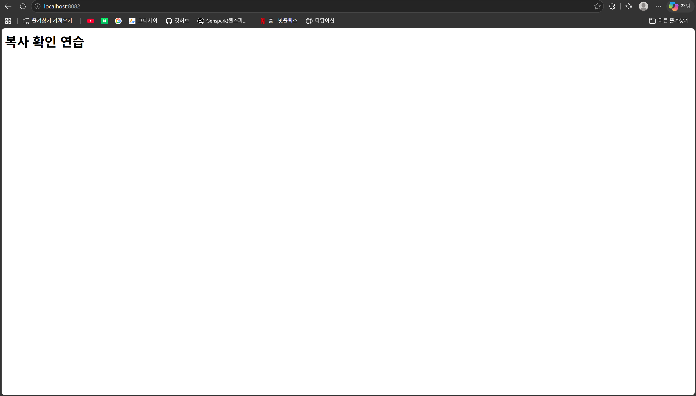

# 챕터 7 — 포트 매핑과 웹 접속

## 연결 설정과 확인 계획

학습한 실행 명령:

```bash
docker run -d --name my-web -p 8080:80 workshop-web:1.0
```

원본 요구사항에 맞춰 호스트 8080 포트와 컨테이너 80 포트를 직접 연결하는 예시다. [이미지 제작·run의 실제 제공 출력](../ch06/build-run.md)을 보관했다. 실제 브라우저 응답과 주소창 증거는 아직 미확인이다.

접속할 주소: http://localhost:8080

- localhost: 브라우저를 실행한 내 컴퓨터.
- 8080: 실행 명령에서 지정한 호스트 포트.
- Docker는 해당 요청을 컨테이너의 NGINX 80번으로 전달하도록 설정된다.

다음은 Windows 브라우저 주소창에서 접속해 만든 제목이 표시되는지 확인하는 것이다. 성공 보고와 별개로 최종 제출에는 주소창의 포트와 응답이 함께 보이는 실제 화면을 확보해야 한다. 아직 이를 수집한 것으로 표시하지 않는다.

## 첫 웹 페이지 접속 — 학습자 보고

학습자는 http://localhost:8080 접속 후 “내 개발 작업실”이라고 나온다고 보고했다. 브라우저 응답 성공 보고로 기록하며 실제 화면 캡처와는 구분한다.

도우미는 컴퓨터 사용 스킬로 해당 Edge 창을 찾아 화면 증거를 수집하려 했으나 도구가 현재 브라우저 URL을 충분히 확신할 수 없어 정책 확인을 수행하지 못한다는 이유로 그 턴의 컴퓨터 사용을 중단했다. 화면을 읽거나 이미지 파일을 확보한 것으로 기록하지 않는다. 주소창과 응답이 함께 보이는 실제 증거는 아직 보완 대상이다.

## 최종 Compose 서버 접속 — 실제 화면 확보

이후 이미지 2.0의 제목을 “복사 확인 연습”으로 변경하고 재빌드·컨테이너 교체한 뒤 학습자가 `스크린샷 2026-11-10 203437.png`를 작업 폴더에 제공했다. 도우미가 로컬 이미지 파일을 직접 열어 다음을 확인했다.

- 브라우저 주소창: `localhost:8082`
- 페이지 제목: `복사 확인 연습`
- 화면에서 토큰·비밀번호·개인키·인증 코드는 보이지 않는다. 즐겨찾기 표시줄은 포함돼 있다.

원본을 변경하지 않고 제출용 경로에 동일한 이미지 파일을 복사했다.



연결 설정은 [환경 변수·Compose 기록](../ch08/environment.md)의 `8082:8080`이다. 이후 제공된 `docker ps -a`에서도 이미지 workshop-web:2.0의 web-web-1이 Up 상태로 `0.0.0.0:8082->8080/tcp, [::]:8082->8080/tcp`를 표시했다. [HTML 재빌드 비교](../ch06/copy-rebuild.md)와 함께 현재 서버의 접속 증거로 사용한다. 이전 8080 서버의 당시 화면을 확보했다는 뜻은 아니다.
